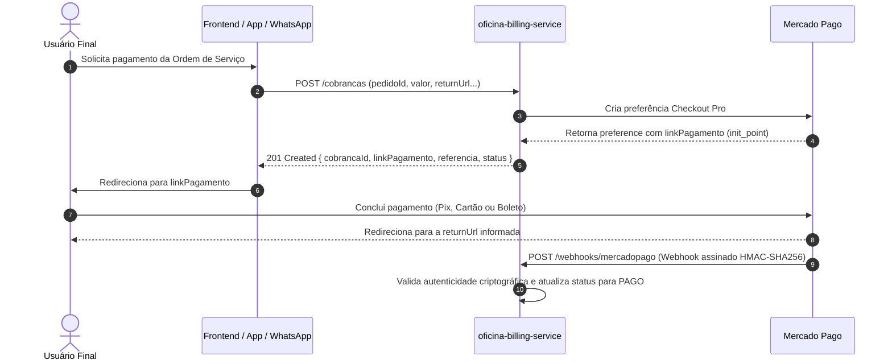

# Oficina Billing Service

Microsserviço de **Faturamento e Cobranças** da oficina mecânica, responsável pela gestão do ciclo de vida de **Orçamentos**, geração de links de pagamento via **Mercado Pago Checkout Pro (API Headless)** e conciliação financeira assíncrona por meio de **Webhooks com validação criptográfica HMAC-SHA256**.

Desenvolvido como parte do ecossistema de microsserviços da pós-graduação **SOAT (Software Architecture) da FIAP**.

---

## 🛠️ Stack Tecnológica

| Componente | Tecnologia | Versão / Detalhes |
| :--- | :--- | :--- |
| **Linguagem** | Java | 25 (compatível com 21+) |
| **Framework Base** | Spring Boot | 4.1.1 (Spring WebMvc, Spring Data JPA, Spring Validation) |
| **Banco de Dados Principal** | PostgreSQL | 15 (Alpine via Docker) |
| **Banco de Dados em Memória** | H2 Database | Perfil `local` para testes e desenvolvimento rápido |
| **ORM / Persistência** | Hibernate ORM | 7.4.x |
| **SDK de Pagamentos** | Mercado Pago Java SDK | 2.1.21 (`com.mercadopago:sdk-java`) |
| **Automação de Build** | GNU Make | `Makefile` cross-platform (Windows / Linux / macOS) |
| **Conteinerização** | Docker & Docker Compose | Multi-stage build com `eclipse-temurin:25` |
| **Documentação da API** | SpringDoc OpenAPI | 3.1.0 (Swagger UI v3) |
| **Produtividade** | Lombok | 1.18.x |
| **Testes Unitários / Mock** | JUnit 5 & Mockito | 40 testes automatizados via Maven Surefire |
| **Testes E2E / API Client** | Bruno | Coleção completa de requisições em `src/test/bruno/` |

---

## 🏛️ Arquitetura

O microsserviço segue os princípios da **Clean Architecture (Arquitetura Limpa)** e **Ports & Adapters (Arquitetura Hexagonal)**, com as dependências fluindo sempre de fora para dentro:

```
[ Adapters: Web / Persistence / MercadoPago ] ──> [ Application: Use Cases / Gateways ] ──> [ Domain: Entidades / Regras de Negócio ]
```

* **`domain/`**: Entidades de negócio puras (`Cobranca`, `Orcamento`, `ItemOrcamento`) e regras invariantes. Não possui dependências do framework Spring nem de infraestrutura externa.
* **`application/`**: Casos de uso (`CriarCobrancaUseCase`, `ProcessarWebhookMercadoPagoUseCase`, `GerarOrcamentoUseCase`, `AprovarOrcamentoUseCase`, etc.) e interfaces de saída (Gateways).
* **`adapters/`**:
  * `web/`: Controladores REST (`CobrancaController`, `OrcamentoController`, `MercadoPagoWebhookController`), DTOs e tratamento global de exceções ([GlobalExceptionHandler](src/main/java/com/mecanica/oficina_billing_service/adapters/web/GlobalExceptionHandler.java)).
  * `persistence/`: Repositórios Spring Data JPA e gateways de persistência.
  * `mercadopago/`: Integração oficial com a API do Mercado Pago via SDK e validador de assinatura criptográfica HMAC-SHA256 ([MercadoPagoWebhookValidator](src/main/java/com/mecanica/oficina_billing_service/adapters/mercadopago/MercadoPagoWebhookValidator.java)).
  * `config/`: Propriedades tipadas e configurações de ambiente.

---

## 🗄️ Banco de Dados e Justificativa da Escolha

O banco de dados relacional **PostgreSQL 15** foi selecionado como banco principal do serviço pelos seguintes motivos técnicos:

1. **Garantias ACID e Consistência Transacional**:
   * Por se tratar de um serviço com impacto financeiro (faturamento de ordens de serviço, cálculo de orçamentos e conciliação de pagamentos), a consistência estrita dos dados é imprescindível. O PostgreSQL assegura transações atômicas e isoladas, mitigando o risco de cobrança duplicada e concorrência na transição de estados.
2. **Precisão Monetária Exata**:
   * Uso nativo do tipo `numeric(12,2)` para cálculo e persistência de valores financeiros, evitando erros clássicos de ponto flutuante (`float`/`double`).
3. **Integridade Referencial e Constraints**:
   * Garantia de integridade com Foreign Keys entre orçamentos e itens, além de restrições de unicidade em `preference_id` e `referencia` para rastreabilidade fiscal.
4. **Tipos Nativos e Auditoria**:
   * Uso nativo de `UUID` como identificador público das cobranças e orçamentos, e timestamps com fuso horário (`timestamp with time zone`) para auditoria de criação e liquidação.
5. **Banco H2 Auxiliar (In-Memory)**:
   * Disponibilizado sob o perfil `local` para acelerar o ciclo de desenvolvimento e viabilizar a execução dos 40 testes automatizados em pipelines de CI/CD sem a necessidade de instanciar containers externos.

---

## 💳 Integração Mercado Pago Checkout Pro (API Headless)

O serviço é **100% headless** (sem interface gráfica ou assets estáticos no backend). O fluxo de pagamento opera via **redirecionamento nativo**:



### Exemplo de Requisição: `POST /cobrancas`
```http
POST /cobrancas HTTP/1.1
Host: localhost:8082
Content-Type: application/json

{
  "pedidoId": "OS-2026-001",
  "descricao": "Revisão geral e troca de pastilhas de freio",
  "valor": 250.00,
  "payerEmail": "cliente@email.com",
  "payerName": "Carlos Silva",
  "payerCpf": "12345678901",
  "returnUrl": "https://meufrontend.com.br/pedidos/OS-2026-001/retorno"
}
```

### Exemplo de Resposta (`201 Created`):
```json
{
  "cobrancaId": "9b1deb4d-3b7d-4bad-9bdd-2b0d7b3dcb6d",
  "pedidoId": "OS-2026-001",
  "valor": 250.00,
  "linkPagamento": "https://sandbox.mercadopago.com.br/checkout/v1/redirect?pref_id=3784984170-...",
  "referencia": "oficina-billing:dev:OS-2026-001",
  "status": "PENDENTE"
}
```

---

## 🚀 Como Executar

### Pré-requisitos
* **Docker e Docker Compose** instalados (ou ferramenta `make`).
* **Java 25** (ou JDK 21+) caso deseje compilar ou executar fora do container.

---

### Execução via `make` (Padrão Recomendado)

O projeto conta com um [`Makefile`](Makefile) padronizado, compatível com o ecossistema da oficina:

| Comando | Descrição |
| :--- | :--- |
| `make start` | Limpa volumes antigos, compila a imagem Docker e sobe o `billing-app` e `billing-db` com logs. |
| `make dev` | Sobe apenas o PostgreSQL via Docker e aguarda ficar pronto (`pg_isready`), liberando o terminal para rodar o backend localmente na IDE. |
| `make debug` | Sobe o PostgreSQL e inicia o Spring Boot local com suporte a **Remote JVM Debug na porta 5006** (Attach na IDE). |
| `make up` | Sobe os containers em segundo plano (`docker compose up -d`). |
| `make down` | Para os containers e remove volumes criados. |
| `make build` | Compila o projeto e gera o arquivo `.jar` pulando testes. |
| `make logs` | Exibe os logs em tempo real da aplicação (`billing-app`). |
| `make logs-db` | Exibe os logs em tempo real do banco de dados (`billing-db`). |
| `make test` | Executa todos os testes unitários e de integração via Maven. |
| `make test-e2e` | Executa os testes de API de ponta a ponta com o Bruno CLI. |
| `make clean` | Executa o clean do Maven e remove imagens/volumes locais do Docker. |
| `make info` | Exibe no terminal as portas e URLs de acesso da aplicação e do banco. |

---

### Execução Manual sem `make`

#### Opção 1: Via Docker Compose Direto
```bash
docker compose up --build
```

#### Opção 2: Banco em Memória H2 (Desenvolvimento Rápido sem Docker)
```powershell
# Windows
.\mvnw.cmd spring-boot:run

# Linux / macOS
./mvnw spring-boot:run
```
*(O perfil `local` com H2 é o default quando nenhuma configuração de PostgreSQL externa é informada).*

#### Opção 3: PostgreSQL via Docker + Spring Boot Local
```powershell
# 1. Sobe apenas o banco
docker compose up -d billing-db

# 2. Inicia o serviço apontando para o banco
.\mvnw.cmd spring-boot:run "-Dspring-boot.run.profiles=default"
```

---

### Endpoints e Interfaces Úteis

* **Swagger UI (Documentação Interativa OpenAPI):** [http://localhost:8082/swagger-ui.html](http://localhost:8082/swagger-ui.html)
* **OpenAPI Docs (JSON):** [http://localhost:8082/v3/api-docs](http://localhost:8082/v3/api-docs)
* **H2 Web Console:** [http://localhost:8082/h2-console](http://localhost:8082/h2-console)
  * *JDBC URL:* `jdbc:h2:mem:billing_db`
  * *User Name:* `sa`
  * *Password:* *(deixar em branco)*

---

### Variáveis de Ambiente Suportadas

É possível configurar as variáveis via arquivo [`.env`](.env.example) ou variáveis de ambiente do sistema:

| Variável | Descrição | Valor Padrão |
| :--- | :--- | :--- |
| `APP_PORT` | Porta HTTP da aplicação | `8082` |
| `DB_PORT` | Porta mapeada do PostgreSQL no host | `5432` |
| `POSTGRES_DB` | Nome do banco de dados | `billing_db` |
| `POSTGRES_USER` | Usuário do PostgreSQL | `postgres` |
| `POSTGRES_PASSWORD` | Senha do PostgreSQL | `123` |
| `SPRING_PROFILES_ACTIVE` | Perfil ativo do Spring Boot | `local` (ou `default` no Docker) |
| `MP_ACCESS_TOKEN` | Credencial privada de API do Mercado Pago | Token de teste pré-configurado |
| `MP_WEBHOOK_SECRET` | Chave secreta para validação criptográfica HMAC | Vazia (modo permissivo em dev) |
| `MP_WEBHOOK_PUBLIC_URL` | URL pública onde o Mercado Pago enviará notificações | `http://localhost:8082/webhooks/mercadopago` |
| `MP_BACK_URL_SUCCESS` | URL padrão de redirecionamento pós-aprovação | `https://oficina.com.br/pagamentos/sucesso` |

---

## 🧪 Como Executar os Testes

O projeto adota uma estratégia de testes em duas camadas: **Testes Automatizados (Unitários e de Integração)** e **Testes de Contrato E2E**.

### 1. Testes Automatizados (Maven)

A suíte possui **40 testes automatizados** cobrindo entidades de domínio, orçamentos, criação de preferências no Checkout Pro com idempotência, tratamento semântico de erros HTTP e validação criptográfica HMAC-SHA256 de webhooks.

* **Via Make:**
  ```bash
  make test
  ```
* **Via Maven Wrapper:**
  ```powershell
  # Windows
  .\mvnw.cmd clean test

  # Linux / macOS
  ./mvnw clean test
  ```

* **Executar classe de teste específica:**
  ```powershell
  # Validação criptográfica HMAC-SHA256 e replay attacks em Webhooks
  .\mvnw.cmd test -Dtest=MercadoPagoWebhookValidatorTest

  # Controller REST de Cobranças
  .\mvnw.cmd test -Dtest=CobrancaControllerTest

  # Processamento de Webhooks e reconciliação
  .\mvnw.cmd test -Dtest=ProcessarWebhookMercadoPagoUseCaseTest

  # Gateway com SDK do Mercado Pago
  .\mvnw.cmd test -Dtest=MercadoPagoClientGatewayTest
  ```

---

### 2. Testes E2E com Bruno (API Client)

A coleção completa de requisições está disponível em [`src/test/bruno/`](src/test/bruno/).

#### Suíte Sequencial do Caminho Feliz (`caminho-feliz/`):
1. `01 - Gerar Orcamento`: Cria um orçamento com serviços e insumos.
2. `02 - Consultar Orcamento por ID`: Valida o orçamento gravado.
3. `03 - Consultar Orcamento por OS`: Valida a busca vinculada à Ordem de Serviço.
4. `04 - Enviar Orcamento ao Cliente`: Transição de status para `ENVIADO`.
5. `05 - Aprovar Orcamento`: Transição de status para `APROVADO`.
6. `06 - Criar Cobranca Mercado Pago`: Cria a cobrança e extrai a URL do Checkout Pro.
7. `07 - Consultar Cobranca por ID`: Consulta o status `PENDENTE` da cobrança.
8. `08 - Consultar Cobranca por Pedido OS`: Consulta a cobrança vinculada ao pedido.
9. `09 - Simular Webhook Mercado Pago`: Dispara evento de pagamento aprovado.
10. `10 - Listar Orcamentos` / `11 - Listar Cobrancas`: Validações de listagem.

#### Executando via Bruno Desktop:
1. Abra o aplicativo [Bruno](https://www.usebruno.com/).
2. Selecione **Open Collection** e selecione a pasta `src/test/bruno/`.
3. Escolha o ambiente **`local`** no canto superior direito.
4. Clique com o botão direito na pasta **`caminho-feliz`** e selecione **Run Folder**.

#### Executando via Linha de Comando (Bruno CLI):
```bash
# Via Make:
make test-e2e

# Ou diretamente via npx:
npx @usebruno/cli run src/test/bruno/caminho-feliz --env local
```

---

## 📄 Licença

Distribuído sob a licença [MIT](LICENSE).
