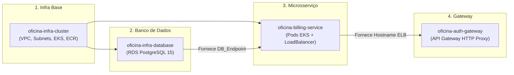
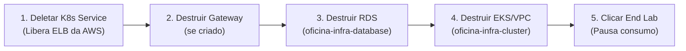

# 🚀 Guia de Deploy e Destruição na AWS (EKS + RDS + CD Independente)

Este guia orienta o processo completo para provisionar, implantar, testar e posteriormente destruir todos os recursos do **`oficina-billing-service`** na nuvem da **AWS**, com foco na esteira automatizada de Continuous Deployment (CD) e na gestão eficiente de créditos do **AWS Learner Lab / AWS Academy**.

---

## 🧭 Visão Geral do Ecossistema

O `oficina-billing-service` não opera isolado na AWS. Ele se conecta à infraestrutura compartilhada gerenciada pelos demais repositórios do grupo:



---

## 🔑 1. Pré-requisitos & AWS Learner Lab

Como as sessões do **AWS Learner Lab** expiram a cada ~4 horas:

1. Acesse o painel do **AWS Academy** e clique em **Start Lab** (aguarde o status ficar verde).
2. Clique no botão **AWS Details** e copie as credenciais temporárias:
   * `AWS_ACCESS_KEY_ID`
   * `AWS_SECRET_ACCESS_KEY`
   * `AWS_SESSION_TOKEN`
3. Atualize esses 3 Secrets no GitHub (**Settings > Secrets and variables > Actions**) nos repositórios que serão executados:
   * [`oficina-infra-cluster`](../../oficina-infra-cluster)
   * [`oficina-infra-database`](../../oficina-infra-database)
   * [`oficina-billing-service`](../)

### 🔐 Secrets adicionais necessários em `oficina-billing-service`:

| Secret | Descrição |
| :--- | :--- |
| `RDS_PASSWORD` | Senha master definida para o banco RDS PostgreSQL (mesmo valor de `oficina-infra-database`). |
| `MP_ACCESS_TOKEN` | Token privado de API do Mercado Pago (Sandbox ou Produção). |
| `MP_WEBHOOK_SECRET` | Chave secreta de assinatura HMAC-SHA256 configurada no webhook do Mercado Pago. |
| `MP_PUBLIC_KEY` | Chave pública do Mercado Pago. |

---

## 🗄️ 2. Particularidade do Banco de Dados (`billing_db`)

Para economizar os créditos limitados do Learner Lab, o serviço utiliza a **mesma instância física do RDS** criada por `oficina-infra-database`, porém isolado em um **database lógico exclusivo (`billing_db`)**.

Como o Terraform do RDS cria apenas a base padrão `oficina_db`, na **primeira vez** que a instância RDS for provisionada, execute via client SQL conectado ao RDS:
```sql
CREATE DATABASE billing_db;
```
*(Após isso, o Spring Boot/Hibernate criará automaticamente todas as tabelas e índices).*

---

## 🚀 3. Roteiro de Subida via CI/CD (Ordem Obrigatória)

Siga rigorosamente a sequência de dependências abaixo:

### Passo 3.1: Subir a Infraestrutura Base (`oficina-infra-cluster`)
1. No repositório [`oficina-infra-cluster`](../../oficina-infra-cluster), vá na aba **Actions** e selecione o workflow **Terraform - CI/CD** (`deploy.yml`).
2. Clique em **Run workflow**.
3. No campo `TF_BUCKET_NAME`, digite o nome do seu bucket S3 do Terraform State (ex: `oficina-tfstate-seu-nome`).
4. Aguarde a conclusão (~10 a 15 minutos). Isso criará a VPC, Subnets, o cluster EKS `eks-oficina-terraform` e o repositório ECR `oficina-billing-service`.

---

### Passo 3.2: Subir o Banco de Dados RDS (`oficina-infra-database`)
1. No repositório [`oficina-infra-database`](../../oficina-infra-database), vá na aba **Actions** e selecione **RDS - CI/CD** (`deploy.yml`).
2. Clique em **Run workflow** e informe o mesmo `TF_BUCKET_NAME`.
3. Ao término do workflow, abra a execução, expanda o step **Exibir endpoint do RDS** e **copie o valor do `DB_Endpoint`** (ex: `terraform-2026xxxx.xxxx.us-east-1.rds.amazonaws.com`).

---

### Passo 3.3: Deploy do `oficina-billing-service` (CD Independente)
1. No repositório [`oficina-billing-service`](../), vá na aba **Actions** e selecione o workflow **CD - Deploy na AWS (EKS)** (`deploy.yml`).
2. Clique em **Run workflow**.
3. No campo `rds_endpoint`, cole o endpoint obtido no passo anterior (sem a porta `:5432`).
4. Confirme a execução. A esteira irá:
   * Compilar o projeto e empacotar a imagem Docker multi-stage (`eclipse-temurin:25`).
   * Efetuar o push da imagem para o ECR `oficina-billing-service`.
   * Atualizar o `kubeconfig` para o cluster `eks-oficina-terraform`.
   * Gerar efemeramente os Secrets e ConfigMaps com o `rds_endpoint`.
   * Aplicar os manifestos via Kustomize (`kubectl apply -k k8s/overlays/aws`) e aguardar o rollout dos pods.

---

### Passo 3.4 (Opcional): Subir o API Gateway (`oficina-auth-gateway`)
Caso queira expor o microsserviço através do gateway unificado com validação de token JWT:
1. Obtenha o hostname externo do LoadBalancer gerado pelo billing (ver seção de testes abaixo).
2. No repositório [`oficina-auth-gateway`](../../oficina-auth-gateway), acione o workflow de deploy informando o `billing_service_base_url`.

---

## 🧪 4. Como Validar e Testar na AWS

### 4.1. Conectar ao EKS e obter o endereço público
No terminal com AWS CLI configurado com as chaves do lab ativo:
```bash
# Atualiza o contexto local do kubectl
aws eks update-kubeconfig --name eks-oficina-terraform --region us-east-1

# Obtém o status dos pods
kubectl get pods -l app=oficina-billing

# Obtém o endereço DNS do LoadBalancer
kubectl get svc oficina-billing
```
Copie o endereço exibido na coluna **`EXTERNAL-IP`** (ex: `k8s-default-oficinab-xxxx.us-east-1.elb.amazonaws.com`).

---

### 4.2. Validar Healthcheck do Actuator
```bash
curl -i http://<EXTERNAL-IP>:8082/actuator/health
```
**Resposta esperada:** `HTTP/1.1 200 OK`
```json
{"status":"UP"}
```

---

### 4.3. Documentação OpenAPI / Swagger UI
Abra no navegador:
```
http://<EXTERNAL-IP>:8082/swagger-ui.html
```

---

### 4.4. Criar Cobrança de Teste (Checkout Pro)
```bash
curl -X POST http://<EXTERNAL-IP>:8082/cobrancas \
  -H "Content-Type: application/json" \
  -d '{
    "pedidoId": "OS-2026-TESTE-01",
    "descricao": "Troca de Pastilhas e Fluido de Freio",
    "valor": 180.00,
    "payerEmail": "cliente.teste@email.com",
    "payerName": "Carlos Silva",
    "payerCpf": "12345678901",
    "returnUrl": "https://oficina.com.br/retorno"
  }'
```
**Resposta esperada:** `HTTP/1.1 201 Created` contendo o `linkPagamento` do Mercado Pago e `status: "PENDENTE"`.

---

## 🛑 5. Guia de Destruição (Para NÃO Gastar Créditos)

> [!CAUTION]
> ### ⚠️ REGRA CRÍTICA DE DESTRUIÇÃO
> Quando o Kubernetes cria um `Service` do tipo `LoadBalancer`, a AWS instancia um **Elastic Load Balancer (ELB)** diretamente na VPC e nas Subnets.  
> **Se você rodar `terraform destroy` no cluster antes de apagar o Service do Kubernetes, a AWS bloqueará a destruição da VPC e dos Security Groups, mantendo os recursos órfãos ativos e consumindo créditos continuamente!**

Siga a ordem estrita de destruição:



### Passo 5.1: Remover os Recursos do Kubernetes (Libera o Load Balancer da AWS)
No terminal local (com `kubectl` conectado ao cluster):
```bash
# Na raiz de oficina-billing-service:
kubectl delete -k k8s/overlays/aws
```
> Aguarde ~1 minuto e confira se o serviço foi removido da AWS:
```bash
kubectl get svc oficina-billing # Deve retornar erro NotFound
```

---

### Passo 5.2: Destruir o API Gateway (se tiver subido)
No diretório `oficina-auth-gateway/terraform`:
```bash
terraform destroy -auto-approve \
  -var="infra_state_bucket=SEU_BUCKET_S3" \
  -var="jwt_secret=dummy" \
  -var="rds_password=dummy" \
  -var="rds_endpoint=dummy" \
  -var="app_api_base_url=dummy"
```

---

### Passo 5.3: Destruir o Banco RDS
No diretório `oficina-infra-database`:
```bash
terraform destroy -auto-approve \
  -var="infra_state_bucket=SEU_BUCKET_S3" \
  -var="db_password=SUA_SENHA_RDS"
```
*(Aguarde ~3 a 5 minutos até o RDS ser finalizado).*

---

### Passo 5.4: Destruir o Cluster EKS, ECR e a VPC
No diretório `oficina-infra-cluster`:
```bash
terraform destroy -auto-approve
```
*(Aguarde ~10 minutos para remoção dos Node Groups, EKS Control Plane, Subnets e VPC).*

---

### Passo 5.5: Encerrar o Lab no AWS Academy
1. No console do AWS Academy, clique no botão **End Lab**.
2. Confirme o encerramento da sessão. O consumo de créditos do lab é interrompido imediatamente.
